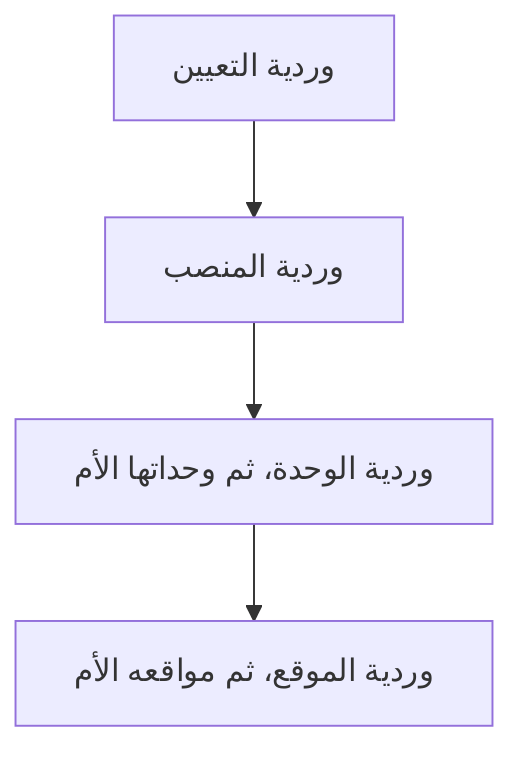

يشرح هذا الفصل تطبيق الموارد البشرية في KayanOS بمثال موظف واحد من شركة الأفق: نحدد وظيفته ودوامه، ونراجع ما سُجّل، ثم نفحص مستحقاته قبل الصرف.

## 3.1 ما المشكلة التي يساعدك هذا التطبيق على حلها؟

عندما تتوزع بيانات الموظفين والدوام والإجازات بين ملفات مختلفة، يبدأ إعداد الراتب بالبحث والمطابقة. تطبيق الموارد البشرية يجمع بيانات الشخص ووظيفته ودوامه، ويتيح مراجعة الإجازات وبنود الراتب في مسار واحد.

سنطبّق في شركة الأفق مثال موظف واحد: نحدد وظيفته ودوامه، نراجع ما سُجل، ثم نفحص مستحقاته قبل الصرف. بعد نجاح المثال نكرره لبقية الفريق.

## 3.2 من يستخدمه، ومتى؟

مسؤول الإعداد يجهّز الأشخاص والوظائف مرة أولى. مسؤول الموارد البشرية يراجع التغييرات والدوام والإجازات يومياً، والمسؤول عن الرواتب يراجع المستحقات دورياً. الموظف يطّلع على ما تسمح به صلاحياته، ولا يحتاج إلى إعداد سلم الرواتب أو سياسات المؤسسة.

**جدول 3.1**: اختر النتيجة التي تحتاجها الآن

| أحتاج إلى... | ما يقدمه التطبيق | النتيجة التي أراجعها |
| :-- | :-- | :-- |
| معرفة من يشغل الوظيفة | ربط العضو بمنصبه بتعيين. | اسم الشخص والوظيفة وفترة العمل. |
| تحديد دوام الفريق | وردية بأيام وساعات واستراحات. | جدول متوقع واضح للموظف. |
| فهم الغياب أو اختلاف الساعات | حضور وجداول دوام وإجازات وتصحيحات. | تفسير اليوم قبل احتساب أثره. |
| مراجعة المستحقات | مدخلات وقسائم وكشوف رواتب. | بنود ومبالغ يمكن مراجعتها قبل الصرف. |

## 3.3 قبل التطبيق: تأكد من وجود الموظف في وظيفته

افتح «الموارد البشرية»، ثم «القوى العاملة»، ثم «التعيينات». افتح تعيين سارة وتأكد من العضو والمنصب وتاريخ بدء العمل. إذا لم يكن موجوداً، نفّذ خطوات [القسم 2.6](/organization-setup) أولاً. استخدم سجل سارة نفسه عند تغيير وظيفتها لاحقاً.

## 3.4 الورديات: تحديد الدوام المتوقع

**الوردية** تحدد أيام العمل وساعاته والاستراحات المتوقعة. أنشئ «الدوام الإداري» مرة للفريق؛ راجع الدخول والخروج الفعليين في الحضور.

**جدول 3.2**: اختيار نوع الوردية

| النوع | ماذا تُدخل؟ | مثال توضيحي |
| :-- | :-- | :-- |
| عادي | فترة عمل محددة، واستراحة عند الحاجة. | من 09:00 إلى 17:00. |
| مقسم | أكثر من فترة عمل، دون تداخل. | من 09:00 إلى 13:00، ثم من 16:00 إلى 20:00. |
| مرن | مدة العمل المطلوبة بالساعات والدقائق. | مدة 08:00؛ دون تحديد فترة بداية ونهاية في النموذج. |
| ماراثون | مدة العمل المطلوبة، كما يعرضها النموذج لهذا النوع. | لا يفترض الدليل دورة أيام عمل وراحة تلقائية من الاسم وحده. |

**طبّق مثال الأفق (ينفذه مسؤول الموارد البشرية):**

<Steps>
  <Step title="أنشئ الوردية">
    افتح «الموارد البشرية»، ثم «الوقت»، ثم «الورديات»، واختر الإضافة. اكتب الاسم «الدوام الإداري» والرمز `HZN-S-01`، واختر النوع «عادي».
  </Step>
  <Step title="اختر الأيام والمنطقة الزمنية">
    اختر الأحد والاثنين والثلاثاء والأربعاء والخميس. اختر المنطقة الزمنية `Asia/Damascus`. الاسم والرمز والنوع ويوم عمل واحد على الأقل <Badge color="green">إلزامي تقنياً</Badge>.
  </Step>
  <Step title="اضبط الساعات والاستراحة">
    في «ساعات العمل» اضبط البدء على 09:00 والنهاية على 17:00. في «الاستراحات» عدّل الفترة الموجودة إلى 13:00 حتى 13:30؛ لا تضف فترة ثانية للمثال. الاستراحة <Badge>اختياري</Badge> ويمكن حذفها عند عدم الحاجة.
  </Step>
  <Step title="تحقق من الإجمالي واحفظ">
    تأكد أن «إجمالي الساعات» يعرض 07:30: ثماني ساعات ناقص نصف ساعة. هذه قيمة يحسبها النظام. اضغط «حفظ»، ثم افتح الوردية من القائمة وتأكد من القيم.
  </Step>
</Steps>

**الأنواع الأخرى:** أضف فترات المقسم منفصلة. أدخل مدة المرن والماراثون بالساعات والدقائق. عند رفض الحفظ، صحح الحقل الذي تظهر تحته الرسالة.

<Note>
  **وردية تعبر منتصف الليل:** الفترة من 22:00 إلى 06:00 تنتهي في اليوم التالي، ومدتها ثماني ساعات قبل الاستراحات. لا تجعل وقت البداية مساوياً للنهاية؛ هذا لا يعني يوماً كاملاً. لا تتداخل فترتان، ولا تضع استراحة خارج فترة العمل.
</Note>

**عند الاستيراد:** راجع المعاينة؛ القالب يطلب ساعات العمل والمدة، بينما تختلف حقول الإدخال اليدوي حسب النوع.

## 3.5 كيف تصل الوردية إلى الموظف؟

قد تأتي الوردية من التعيين نفسه، أو من المنصب، أو من الوحدة التنظيمية أو الموقع. «الوراثة» تعني استخدام الوردية المحددة في سجل أعلى بدلاً من تكرارها يدوياً.

**شكل 3.1**: ترتيب البحث عن الوردية: انتقل إلى المستوى التالي فقط إذا لم توجد وردية.

توقّف عند أول وردية موجودة من الأعلى. يفحص النظام الوحدة وأمهاتها قبل الموقع وأمهاته؛ لا يجمع الجداول معاً.

- ضع الجدول المشترك في الوحدة أو الموقع، وراجع ظهوره في التعيين.
- خيار «تجاوز» يتيح اختيار وردية خاصة بدلاً من الموروثة، عند توفره في الحقل. «إعادة تعيين» تعيد استخدام الوردية الموروثة.
- عند تغيير جدول فريق، راجع التعيينات ذات الوردية الخاصة؛ لا تفترض أنها ستتبع التغيير تلقائياً.

**اجعل الدوام الإداري هو جدول قسم سارة:**

<Steps>
  <Step title="افتح وحدة الموارد البشرية">
    افتح «الموارد البشرية»، ثم «الأساسية»، ثم «الوحدات التنظيمية». افتح «الموارد البشرية» ذات الرمز `HZN-HR`.
  </Step>
  <Step title="اختر الوردية">
    في حقل «الوردية» اختر «الدوام الإداري». إذا كان الحقل يستخدم وردية موروثة ولا يقبل اختياراً خاصاً، استخدم «تجاوز»، ثم اختر الوردية واحفظ.
  </Step>
  <Step title="راجع المنصب">
    افتح «القوى العاملة»، ثم «المناصب»، ثم «مدير الموارد البشرية». راجع أنه مرتبط بوحدة `HZN-HR` وأن ورديته هي «الدوام الإداري».
  </Step>
  <Step title="راجع التعيين">
    افتح تعيين سارة وراجع الوردية. إذا ظهرت وردية أخرى، افحص التعيين والمنصب بالترتيب في الرسم؛ قد يكون لأحدهما اختيار خاص يتقدم على وردية القسم.
  </Step>
</Steps>

**النتيجة:** يظهر الدوام الإداري في تعيين سارة. المثال تدريبي تنفذه بنفسك.

## 3.6 المتابعة اليومية: ماذا حدث في يوم العمل؟

قبل تفسير نقص الساعات، راجع الدخول والخروج والإجازة والعطلة والتصحيحات. عالج سبب الفرق قبل مراجعة المستحقات.

**قبل البدء:** تحتاج إلى موظف له تعيين ووردية، وبيانات حضور مسجلة بالطريقة المستخدمة في مؤسستك. إنشاء الموظف والوردية لا يضيف حركات حضور قديمة تلقائياً.

**جدول 3.3**: فرّق بين الإعداد والواقعة والنتيجة

| الصفحة | ماذا تفعل فيها؟ |
| :-- | :-- |
| جداول الدوام | اختر الموظفين والفترة لمراجعة أوقات العمل المسجلة. |
| الحضور | اختر الشهر، ثم اليوم لمراجعة تفاصيل الحضور. الاطلاع على موظف آخر يحتاج صلاحية. |
| العطل | جهّز مجموعة العطل وسجلاتها؛ العطلة قد تكون يوماً كاملاً أو جزءاً من يوم أو فترة. |
| أنواع الإجازات | عرّف المرجع: مدفوعة، غير مدفوعة، أو مدفوعة جزئياً مع نسبتها. |
| الإجازات | سجّل واقعة إجازة لموظف: النوع والتاريخ والمدة في الحقول المتاحة. |

**افحص يوماً واحداً (ينفذه الموظف أو المسؤول المخوّل):**

<Steps>
  <Step title="افتح الحضور">
    افتح «الموارد البشرية»، ثم «الوقت»، ثم صفحة الحضور. اختر الشهر المطلوب. الموظف يراجع حضوره، والمسؤول يختار العضو الآخر إذا أتاح له النظام ذلك.
  </Step>
  <Step title="قارن اليوم بالوردية">
    افتح يوم عمل من القائمة. قارن الوردية المتوقعة بأوقات الدخول والخروج والمدة المعروضة. سجّل ما يحتاج إلى تفسير، مثل حركة خروج مفقودة.
  </Step>
  <Step title="راجع جداول الدوام">
    افتح «الوقت»، ثم «جداول الدوام» إذا احتجت إلى مراجعة التسجيلات عبر فترة أو لمجموعة موظفين. اضبط الموظفين والتاريخ حتى تطابق الفترة التي تفحصها.
  </Step>
  <Step title="عالج النقص">
    إذا وجدت نقصاً، راجع مصدر التسجيل مع المسؤول عن الدوام. عند وجود تصحيح، افتح «تصحيحات الحضور» وراجع الموظف والتاريخ والحالة قبل اعتبار المشكلة محلولة.
  </Step>
</Steps>

<Check>
  **تحقّق:** تستطيع تفسير الفرق بين المتوقع والمسجل. إذا كانت الشاشة فارغة، راجع الموظف والفترة والصلاحية ومصدر التسجيل؛ الفراغ وحده لا يثبت الغياب.
</Check>

<Note>
  **الوردية وسياسة الحضور:** الوردية تحدد الوقت المتوقع؛ سياسة الحضور تضبط التعامل مع التأخر والإضافي. راجع سياسة المؤسسة والنتيجة؛ لا تفترض خصماً ثابتاً أو أجراً إضافياً تلقائياً.
</Note>

## 3.7 سجّل سبب الغياب: عطلة أم إجازة؟

العطلة يوم أو فترة تعتمدها المؤسسة، أما الإجازة فتخص موظفاً. تسجيل السبب الصحيح يساعد مسؤول الموارد البشرية على تفسير الدوام ومراجعة أثره على الراتب. **نوع الإجازة** هو قاعدة متكررة مثل «سنوية مدفوعة»، و**سجل الإجازة** هو استخدام موظف لهذا النوع في تاريخ محدد.

**جهّز النوع مرة واحدة (مسؤول الموارد البشرية):**

<Steps>
  <Step title="ابحث عن النوع">
    افتح «الموارد البشرية»، ثم «الوقت»، ثم «أنواع الإجازات». ابحث أولاً عن النوع المعتمد في المؤسسة، لتتجنب إنشاء نسخة أخرى منه.
  </Step>
  <Step title="أنشئ نوعاً جديداً عند الحاجة">
    إذا كنت مخوّلاً بإنشاء نوع جديد، اختر الإضافة، واكتب اسماً واضحاً مثل «سنوية مدفوعة». اختر طريقة الدفع المناسبة، وحدد النسبة إذا كان النوع مدفوعاً جزئياً.
  </Step>
  <Step title="احفظ وراجع">
    احفظ، وافتح النوع من القائمة لتراجع اسمه وطريقة الدفع. راجع إتاحته للموظف ضمن إعدادات وظيفته؛ وجود النوع وحده لا يمنح الجميع استحقاقاً.
  </Step>
</Steps>

**سجّل إجازة سارة بعد موافقتها وفق إجراء المؤسسة:**

<Steps>
  <Step title="افتح الإجازات">
    افتح «الوقت»، ثم «الإجازات»، واختر الإضافة.
  </Step>
  <Step title="أدخل بيانات الإجازة">
    اختر سارة في «العضو»، والنوع المعتمد في «نوع الإجازة». أدخل التاريخ المعتمد والمدة في حقول الأيام أو الساعات المناسبة. لتجربة يوم كامل استخدم يوماً واحداً في تاريخ عمل متفق عليه؛ لا تسجّل اليوم نفسه مرة بالأيام ومرة أخرى بالساعات.
  </Step>
  <Step title="احفظ وتحقق">
    أكمل الحقول المطلوبة في نموذج المؤسسة واحفظ. افتح سجل الإجازة مجدداً وتحقق من الموظف والتاريخ والنوع والمدة، ثم راجع الفترة عند مراجعة الحضور والراتب.
  </Step>
</Steps>

**للعطل المشتركة:** افتح «الوقت»، ثم «مجموعات العطل الرسمية»، ثم المجموعة المقصودة. أضف العطلة باسمها وتاريخها، وحدد يوماً كاملاً أو جزءاً من يوم أو فترة. لجزء اليوم أدخل الساعات، وللفترة أدخل بدايتها ونهايتها. احفظ، ثم راجع تفاصيل المجموعة وإسنادها للأقسام أو الوظائف المعنية.

<Check>
  **تحقّق:** تستطيع التمييز بين يوم إجازة سارة وعطلة الفريق كله. إذا لم يظهر الأثر المتوقع، راجع التاريخ والنوع وإسناده وحالة المراجعة؛ إرسال طلب إجازة وحده لا يثبت أن الإجازة اعتُمدت وسُجلت.
</Check>

## 3.8 سلم الراتب وإعداد المستحقات

يحتاج المسؤول عن الرواتب إلى تفسير المبلغ، لا إلى رقم إجمالي فقط. يتيح المسار التالي فصل بيانات الأجر عن المتغيرات، ثم حساب قسيمة الموظف ومراجعتها، ثم جمع القسائم المعتمدة في كشف. ينفذه المسؤول المخوّل بعد إكمال مراجعة الدوام.

**سلم الراتب** مرجع يربط مستويات الخبرة بالمستويات الوظيفية وقيم الأجور. إذا كانت المؤسسة تستخدمه، افتح قسم «سلم الراتب»: جهّز مجموعة «مستويات الخبرة» ومستوياتها وقاعدة الزيادة والعملة، ثم «المستويات الوظيفية» وقيم الأجر المرتبطة بها. احفظ كل إعداد، ثم افتح صفحة «سلم الراتب» وراجع القيم عند تقاطع المستوى الوظيفي والخبرة. وجود سلم لا يكفي وحده لتجهيز راتب موظف؛ راجع بيانات تعيينه وأجره وعملته أيضاً.

**جدول 3.4**: ثلاثة أسماء متشابهة، وثلاثة أغراض مختلفة

| الصفحة | الغرض |
| :-- | :-- |
| مدخلات الرواتب | إضافات أو استقطاعات تُدخل للحساب، مثل مكافأة. راجع الموظف والتاريخ وطريقة الحساب. |
| قسائم الرواتب | تفاصيل حساب راتب الموظف للفترة، وبنود الاستحقاق والاستقطاع والمبلغ الناتج. |
| كشوف الرواتب | تجميع الرواتب المعتمدة للشهر والموظفين المحددين ومتابعة بيانات الصرف. |

**جهّز بيانات الحساب:**

<Steps>
  <Step title="راجع التعيين">
    افتح تعيين الموظف وتأكد من فترة العمل والأجر والعملة، وراجع الدوام والإجازات والتصحيحات للفترة التي ستحتسبها.
  </Step>
  <Step title="ابحث عن مدخل موجود">
    افتح «الموارد البشرية»، ثم «الدفع»، ثم «مدخلات الرواتب». ابحث عن مدخل موجود قبل إضافة مكافأة أو استقطاع جديد للفترة نفسها.
  </Step>
  <Step title="أضف المدخل وعاينه">
    عند الإضافة اختر الموظف والتاريخ ونوع المدخل واتجاهه وطريقة الحساب، وأدخل القيمة المعتمدة. احفظ ثم افتح المدخل، واستخدم «معاينة الاحتساب» لمراجعة المبلغ. استكمل اعتماد المدخل وفق صلاحياتك وإجراء المؤسسة.
  </Step>
</Steps>

**النتيجة:** بيانات الأجر والمتغيرات جاهزة للمراجعة. إذا اختلفت المعاينة عن المتوقع، صحح القيمة أو طريقة الحساب قبل متابعة القسيمة؛ المعاينة لا تعني الصرف.

## 3.9 من قسيمة الموظف إلى كشف الرواتب

**مثال المسار:** راجع قسيمة سارة أولاً، ثم ضمّها إلى كشف الفترة المطلوبة. استخدم الأجر والعملة المعتمدين في مؤسستك؛ أمثلة الدليل لا تحدد أجوراً فعلية.

**أنشئ القسيمة وراجعها:**

<Steps>
  <Step title="ابدأ إنشاء القسائم">
    افتح «الموارد البشرية»، ثم «الدفع»، ثم «قسائم الرواتب»، واضغط «إنشاء قسائم رواتب».
  </Step>
  <Step title="حدد الفترة والصف">
    اختر «نهاية الفترة». تظهر الصفوف المؤهلة، وكل صف يربط عضواً بمنصب. حدد صف سارة ومنصبها. راجع «بداية الفترة»؛ في القسيمة الأولى يمكن تعديلها ويُستخدم تاريخ بدء التعيين افتراضياً.
  </Step>
  <Step title="أنشئ المسودات">
    اضغط زر إنشاء المسودات الذي يعرض العدد المحدد، ثم افتح قسيمة سارة. إذا منعك النظام بسبب مسودة موجودة، افتح تلك المسودة وراجعها أولاً.
  </Step>
  <Step title="احتسب">
    اضغط «احتساب». راجع الفترة وبنود الاستحقاق والاستقطاع والمبلغ المستحق. إذا تغيرت المدخلات، استخدم «إعادة الاحتساب» قبل الاعتماد.
  </Step>
  <Step title="اعتمد">
    بعد مطابقة النتيجة للمستندات المعتمدة، اضغط «اعتماد» وفق صلاحيتك، واقرأ رسالة التأكيد ثم أكّد الاعتماد. ارجع إلى القائمة وراجع ظهور الحالة المعتمدة. لا تعتمد قسيمة لم تُفسَّر بنودها.
  </Step>
</Steps>

**اجمع القسائم في كشف:**

<Steps>
  <Step title="ابدأ توليد الكشف">
    افتح «الدفع»، ثم «كشوف الرواتب»، واختر «توليد كشف الرواتب».
  </Step>
  <Step title="حدد الشهر والموظفين">
    حدد الشهر والسنة، وراجع المرشحات ثم اختر الموظفين المقصودين. يعتمد الكشف على القسائم المعتمدة ضمن النطاق المختار.
  </Step>
  <Step title="ولّد وراجع">
    اضغط «توليد»، وراجع أي رسالة تعارض مع كشف موجود قبل المتابعة. افتح الكشف الناتج وتأكد من الموظفين والفترة والإجمالي والحالة.
  </Step>
</Steps>

<Check>
  **تحقّق:** تستطيع الرجوع من المبلغ في الكشف إلى قسيمة الموظف وبنودها. إذا لم يظهر موظف، راجع الفترة والمرشحات والتعيين وحالة القسيمة قبل إنشاء بيانات جديدة.
</Check>

<Warning>
  **الحساب ليس صرفاً:** إنشاء راتب أو كشف لا يثبت وصول المال إلى الموظف. راجع حالة الصرف وسجلات الدفع وفق إجراء المؤسسة. لا تعتمد أرقام المثال التدريبي كأجور حقيقية.
</Warning>

## 3.10 النتائج والتحقق

<Check>
  **تجربة صغيرة قبل تعميم الإعداد**

  - [ ] عضو سارة مرتبط بمنصبها بتعيين في الفترة الصحيحة.
  - [ ] وردية `HZN-S-01` تُظهر الأيام والأوقات والمنطقة الزمنية المطلوبة.
  - [ ] صافي الوردية في المثال 07:30، والاستراحة داخل وقت العمل.
  - [ ] تظهر الوردية الصحيحة في المنصب والتعيين؛ روجعت أي قيمة متجاوزة للموروث.
  - [ ] روجع يوم حضور فعلي، ولم يُكتفَ بفتح قائمة الحضور.
  - [ ] الإجازات والتصحيحات تخص الموظف والتاريخ المقصودين.
  - [ ] إذا استُخدمت الرواتب: روجعت البنود والعملة والمجموع قبل الاعتماد والصرف.
</Check>

**جدول 3.5**: أخطاء شائعة وخطوة التصحيح

| المشكلة | ما الذي تراجعه؟ |
| :-- | :-- |
| لا تُحفظ الوردية | الاسم والرمز وأيام العمل، ثم الفترات المتداخلة أو الاستراحة خارج العمل. |
| مدة الوردية أقل من المتوقع | الاستراحات؛ فهي تُطرح من إجمالي الفترات في العادي والمقسم. |
| موظف على وردية مختلفة | التعيين والمنصب وأولوية الوحدة على الموقع، وخيار التجاوز. |
| لا يمكن حذف وردية | قد تكون مستخدمة في سجلات أخرى؛ راجع ارتباطاتها أولاً. |
| لا يظهر موظف في كشف الرواتب | الشهر والمرشحات والتعيين والرواتب المعتمدة، وأي تعارض مع كشف موجود. |
| الإجازة لا تعطي النتيجة المتوقعة | نوعها وطريقة دفعها وتاريخها ومدتها، ثم تفاصيل الراتب للفترة. |

## 3.11 العلاقة بالتطبيقات الأخرى

تستخدم المهام والمشاريع الأشخاص والوظائف التي جهّزتها هنا. وقد تستخدم المؤسسة الطلبات لطلب الإجازة أو الموافقة عليها؛ اتبع مسارها المعتمد ولا تساوِ بين إرسال الطلب وتسجيل إجازة مكتملة. عند مراجعة تكلفة مشروع، ارجع إلى تفاصيل توزيع الرواتب المتاحة بدلاً من افتراض أن كل راتب يخص مشروعاً واحداً.

بعد استقرار الأشخاص والدوام، تأتي متابعة العمل في تطبيق **المهام**.
