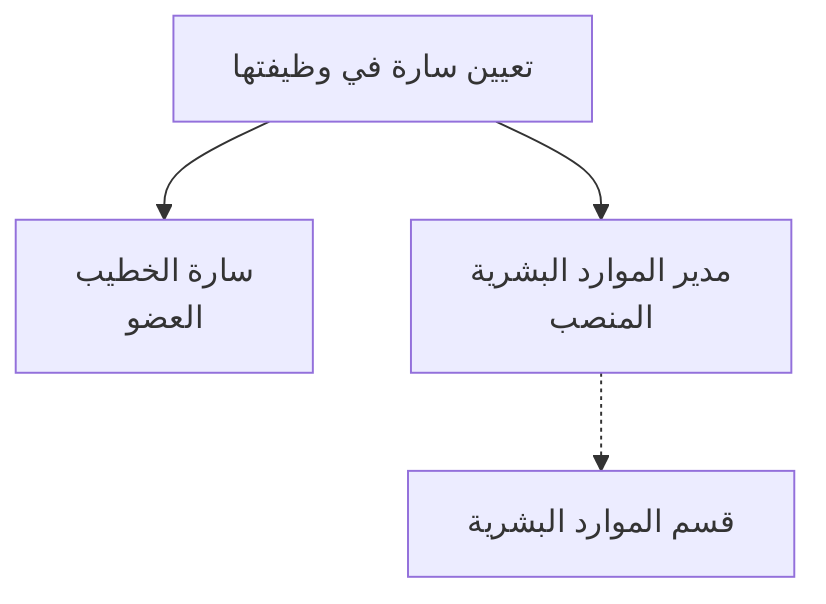
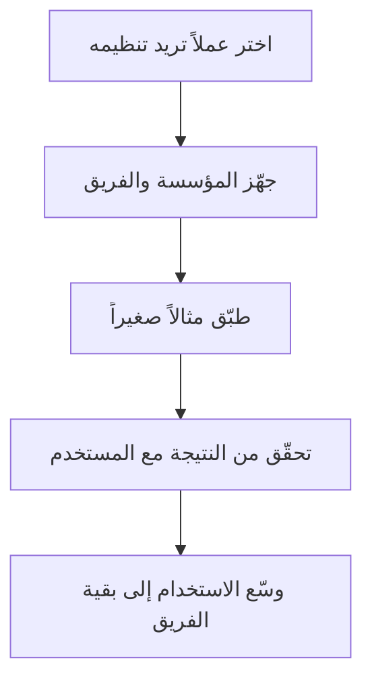

يعرّفك هذا الفصل بنظام KayanOS (كيان): ما المشكلة التي يحلها، ومن يستخدمه، وكيف تجد عملك عند أول دخول، وكيف تنتقل من الفهم إلى التشغيل.

## 1.1 ما هو كيان، ولماذا قد تحتاجه؟

تخيّل أن أسماء الموظفين في ملف، وطلبات العمل في المحادثات، ومواعيد التسليم في دفتر المدير. عندما يسأل عميل عن طلبه، تحتاج إلى سؤال عدة أشخاص لتعرف من يتابعه وأين توقف. ومع توسّع الفريق يصبح هذا البحث جزءاً من العمل اليومي.

**كيان**، واسمه في النظام KayanOS، مساحة عمل تجمع إدارة الموظفين والمهام والمشاريع والطلبات والملفات. يساعد فريقك على تسجيل العمل، وتحديد المسؤول عنه، ومتابعة حالته، والرجوع إلى معلوماته وفق صلاحيات كل شخص.

**جدول 1.1**: من مشكلة يومية إلى استخدام واضح

| المشكلة في العمل | ما يقدمه كيان | الفائدة العملية |
| :-- | :-- | :-- |
| لا نعرف من يتابع العمل أو موعده. | مهام لها مسؤول وموعد وحالة. | تفتح المهمة لتعرف من يعمل عليها وما بقي. |
| بيانات الموظف ووظيفته موزعة. | أعضاء ومناصب وتعيينات في الموارد البشرية. | تعرف من يشغل كل وظيفة وأين يعمل. |
| الطلبات تصل بطرق مختلفة وتنقصها معلومات. | نماذج وطلبات ومسارات مراجعة تُعدّ حسب العمل. | تجمع المعلومات المطلوبة وتتابع الطلب في مكان معروف. |
| يصعب العثور على مستند العمل. | مكتبة ملفات ومرفقات مرتبطة بالعمل. | يرجع الفريق إلى المستند الذي يحتاجه. |
| المدير يحتاج صورة عن سير العمل. | حالات ومشاريع ولوحات معلومات عند إعدادها. | يراجع العمل المسجل ويحدد ما يحتاج متابعة. |

<Tip>
  **ما تحتاجه المؤسسة لنجاح الاستخدام:** تحدد المسؤوليات، وتدخل بيانات صحيحة، وتتفق على معنى «مكتمل». يتيح كيان تنظيم هذه الأمور، ويحدّث الفريق المعلومات أثناء العمل حتى تكون المتابعة مفيدة.
</Tip>

## 1.2 مثال بسيط: يوم عمل في شركة الأفق

نستخدم طوال الدليل شركة وهمية اسمها **شركة الأفق للخدمات**، لها مقر في دمشق وفرع في حلب. سارة تدير الموارد البشرية، وعمر منسق عمليات في فرع حلب.

يصل طلب تجهيز مكتب لموظف جديد. **قبل تنظيم العمل**، قد يبقى الطلب في محادثة، ويسأل المدير أكثر من مرة: من يجهز المكتب؟ ومتى ينتهي؟ وأين فاتورة الشراء؟

**باستخدام كيان** يمكن للفريق العمل بهذه الصورة، بعد إعداد الأدوات المناسبة:

<Steps>
  <Step title="تسجيل الطلب">
    يسجل الطلب ومعلوماته، فيصبح له مكان يرجع إليه الجميع المخوّلون.
  </Step>
  <Step title="تحديد المهمة">
    يحدد المدير العمل المطلوب من عمر وموعده في مهمة واضحة.
  </Step>
  <Step title="تحديث الحالة">
    يحدّث عمر حالة المهمة ويضيف النتيجة أو المستند المطلوب.
  </Step>
  <Step title="المراجعة">
    يفتح المدير العمل ليراجع النتيجة ويتابع ما لم ينتهِ بعد.
  </Step>
</Steps>

هذا مثال لطريقة تنظيم العمل. إنشاء الطلب لا يولّد بقية الخطوات تلقائياً؛ أي انتقال تلقائي يحتاج إلى إعداد مسبق يناسب المؤسسة.

## 1.3 ما الذي ستستخدمه أنت؟

**جدول 1.2**: ابدأ بحسب مسؤوليتك

| دورك في العمل | ما تريد إنجازه | من أين تبدأ؟ |
| :-- | :-- | :-- |
| صاحب العمل أو المدير | فهم ما يقدمه النظام واختيار أول عمل لتنظيمه. | هذا الفصل، ثم مثال صغير في قسم واحد. |
| مسؤول إعداد النظام | تجهيز المؤسسة وحسابات الفريق والأقسام. | [الفصل 2](/organization-setup). |
| مسؤول الموارد البشرية | تنظيم الموظفين والدوام والإجازات والرواتب. | [الفصل 3](/human-resources) بعد تجهيز الفريق. |
| الموظف | الوصول إلى عمله ومتابعته. | خطوات الدخول التالية؛ لا يحتاج إلى إنشاء مؤسسة جديدة. |

<Tip>
  **اختر بداية صغيرة:** في شركة الأفق نبدأ بموظفين ووظيفتين وجدول دوام واحد. نتأكد من النتيجة، ثم نضيف بقية الفريق. لا يلزم تشغيل كل التطبيقات في اليوم الأول.
</Tip>

## 1.4 أول دخول: أين تجد عملك؟

**قبل البدء:** اطلب من مسؤول مؤسستك عنوانها وطريقة دخولك. العنوان مثل `hzn.kayanos.app` في مثالنا؛ استخدم عنوان مؤسستك الحقيقي. إذا كنت تؤسس المؤسسة لأول مرة، انتقل إلى [الفصل 2](/organization-setup).

<Steps>
  <Step title="افتح عنوان المؤسسة">
    افتح عنوان المؤسسة في المتصفح. اختر طريقة الدخول التي جهّزها لك المسؤول: البريد الإلكتروني، أو الهاتف، أو رقم الموظف، ثم أدخل بيانات دخولك.
  </Step>
  <Step title="تأكد من المؤسسة">
    بعد الدخول، تأكد أنك في المؤسسة المقصودة قبل إدخال أي بيانات.
  </Step>
  <Step title="افتح مشغّل التطبيقات">
    افتح «مشغّل التطبيقات» من الصفحة الرئيسية، واختر «الموارد البشرية» لتمريننا.
  </Step>
  <Step title="افتح قائمة الأعضاء">
    افتح «القوى العاملة»، ثم «الأعضاء». هذه قائمة الموظفين، وليست صفحة موظف واحد.
  </Step>
  <Step title="اعرض تفاصيل موظف">
    افتح اسم موظف لعرض تفاصيله. للرجوع اختر اسم الصفحة أو التطبيق من مسار التنقل أعلى الشاشة. ويمكن استخدام البحث للعثور على عمل أو شخص متاح لك.
  </Step>
</Steps>

**شكل 1.1**: اختر التطبيق الذي يخدم عملك من مشغّل التطبيقات.

<Check>
  **تحقّق:** تستطيع الوصول إلى القائمة المقصودة وفتح تفاصيل أحد عناصرها المسموح لك برؤيتها. إذا لم يظهر التطبيق أو زر التعديل، اطلب من مسؤول النظام مراجعة صلاحيتك؛ قد تختلف قائمتك عن قائمة زميلك.
</Check>

## 1.5 افهم أسماء الشاشة من مثال واحد

نريد أن يعرف النظام أن سارة تعمل مديراً للموارد البشرية في دمشق. هذه هي الأسماء التي ستقابلها، ومعنى كل اسم في هذا المثال:

**جدول 1.3**: لغة العمل وأسماؤها في كيان

| اسم الشاشة | معناه ببساطة |
| :-- | :-- |
| المؤسسة | مساحة عمل شركة الأفق وحسابات فريقها. |
| العضو | الشخص الذي يعمل معنا: سارة الخطيب. |
| الوحدة التنظيمية | القسم أو الإدارة: الموارد البشرية. |
| النقطة الجغرافية | مكان العمل: المقر الرئيسي في دمشق. |
| المنصب | الوظيفة: مدير الموارد البشرية. |
| التعيين | تحديد أن سارة هي من تشغل هذه الوظيفة خلال فترة عملها. |
| الدور والصلاحيات | ما يُسمح لسارة أن تراه أو تفعله، مثل عرض الموظفين أو تعديل بياناتهم. |

**شكل 1.2**: أنشئ بيانات الشخص والوظيفة، ثم اربطهما بتعيين. السهم المتصل يعني أن السجل المشار إليه مطلوب أولاً، والسهم المنقّط يعني ارتباطاً اختيارياً.

اقرأ الشجرة من الأعلى إلى الأسفل: التعيين يحتاج إلى شخص ووظيفة موجودين. ربط الوظيفة بقسمها اختياري تقنياً، لكنه يساعدك على معرفة موظفي كل قسم.

## 1.6 ما الذي تختاره لكل نوع من العمل؟

**جدول 1.4**: اختر التطبيق بناءً على ما تريد إنجازه

| أريد أن... | أبدأ من... |
| :-- | :-- |
| أعرف الموظفين ووظائفهم وأراجع دوامهم. | الموارد البشرية. |
| أسند عملاً لشخص وأتابع تنفيذه. | المهام. |
| أنظم عملاً أكبر له خطة وأعمال مترابطة. | المشاريع. |
| أقدم طلباً أو أراجع طلباً ينتظر قراري. | الطلبات أو الموافقات المتاحة في المؤسسة. |
| أرتب موعداً أو أرجع إلى ملف أو محادثة. | التقويم أو مكتبة الملفات أو أدوات التواصل. |
| أجهز نموذجاً خاصاً بعمل المؤسسة. | أدوات البناء، ويتولاها المسؤول المخوّل. |

## 1.7 كيف تنتقل من الفهم إلى التشغيل؟

الفصل التالي يقود مسؤول الإعداد إلى تسجيل فريق صغير. ثم يشرح فصل الموارد البشرية كيفية تحديد دوامه ومراجعته. أما فصول المهام والمشاريع فستُضاف لاحقاً إلى هذا الدليل.

**شكل 1.3**: ابدأ بنتيجة صغيرة مفيدة، ثم وسّع الاستخدام.

<Info>
  **علامات تساعدك أثناء التطبيق:** <Badge color="green">إلزامي تقنياً</Badge> مطلوب للحفظ، <Badge color="blue">موصى به</Badge> يساعدك على تنظيم العمل، <Badge>اختياري</Badge> تستخدمه عند الحاجة، <Badge color="purple">يولّده النظام</Badge> يملؤه النظام. أمثلة الأفق للتعلّم؛ استبدلها ببيانات مؤسستك عند التطبيق الفعلي.
</Info>
