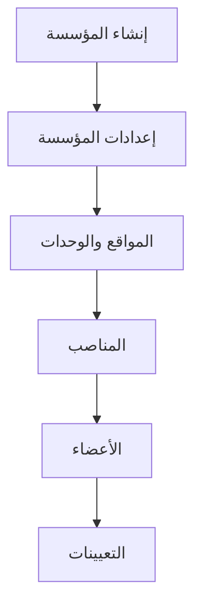
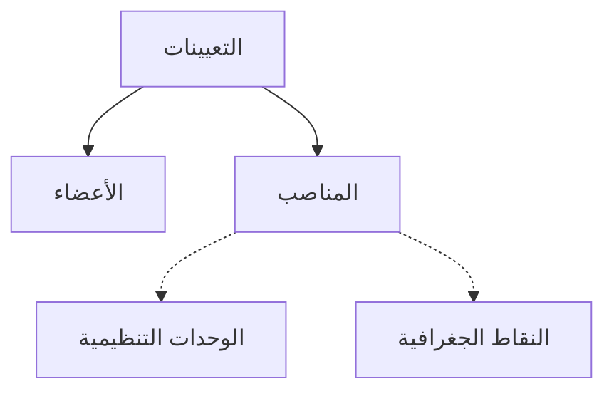

يقود هذا الفصل مسؤول إعداد النظام في KayanOS خلال ست خطوات: إنشاء المؤسسة، وضبط إعداداتها، ثم تجهيز المواقع والوحدات والمناصب والأعضاء والتعيينات، مع مثال شركة الأفق للخدمات.

## 2.1 جهّز مكاناً واحداً لبيانات فريقك

عندما يُكتب اسم الموظف وقسمه في أكثر من ملف، يصعب الحفاظ على نسخة صحيحة. سنجهّز في كيان تعريفاً واضحاً للفريق: من يعمل معنا، وفي أي وظيفة وقسم وموقع. تستخدم التطبيقات هذه البيانات لاحقاً بدلاً من إعادة إدخالها في كل مرة.

**من ينفذ؟** مسؤول إعداد النظام، بالتعاون مع المسؤول عن الموظفين. **متى؟** عند بدء استخدام المؤسسة. إذا كانت المؤسسة موجودة، ابدأ بمراجعة الإعدادات والبيانات الموجودة، ولا تنشئ مؤسسة أو موظفين مكررين.

**نتيجة التمرين:** تستطيع فتح تعيين سارة، ورؤية وظيفتها وقسمها وموقع عملها. سنبدأ بسارة، ثم تكرر الخطوات لعمر وبقية الفريق.

**شكل 2.1**: خطوات الفصل الست.

## 2.2 قبل أن تبدأ

جهّز قائمة صغيرة من أسماء الأقسام والمواقع والوظائف والموظفين، وحدد من يراجعها. **الرمز** هو معرّف تختاره لتجنب الخلط بين الأسماء، مثل `HZN-HR` لقسم الموارد البشرية؛ لا يحتاج إلى معرفة برمجية. **النطاق الفرعي** هو الجزء الذي تختاره لعنوان مؤسستك، مثل `hzn` في `hzn.kayanos.app`.

**جدول 2.1**: ما تحتاج تجهيزه قبل الإنشاء

| البيان | التصنيف | ملاحظة |
| :-- | :-- | :-- |
| بريد إلكتروني أو رقم هاتف | <Badge color="green">إلزامي تقنياً</Badge> | يصله رمز التحقق. |
| اسم المؤسسة | <Badge color="green">إلزامي تقنياً</Badge> | يمكن كتابته بأكثر من لغة. |
| النطاق الفرعي | <Badge color="green">إلزامي تقنياً</Badge> | عنوان المؤسسة، مثل `hzn`. |
| البلد وعدد الموظفين | <Badge color="green">إلزامي تقنياً</Badge> | عدد الموظفين تقديري (فئة). |
| اسم المدير | <Badge color="green">إلزامي تقنياً</Badge> | صاحب الحساب الأول. |
| كلمة مرور المدير | <Badge>اختياري</Badge> | إن تُركت فارغة يصلك رمز لتعيينها لاحقاً. |
| الشعار | <Badge>اختياري</Badge> | صورة حتى 5 ميغابايت. |

## 2.3 الخطوة 1: إنشاء المؤسسة

من شاشة الدخول افتح «إنشاء مؤسسة». هذه الخطوة لصاحب المؤسسة أو المسؤول الذي يجهزها أول مرة، وليست لكل موظف جديد. اتبع الخطوات الأربع:

<Steps>
  <Step title="جهة الاتصال">
    اختر البريد الإلكتروني أو رقم الهاتف وأدخله.
  </Step>
  <Step title="التحقق">
    أدخل الرمز المكوّن من 6 أرقام. الرمز صالح 10 دقائق، ويمكن طلب رمز جديد بعد دقيقة.
  </Step>
  <Step title="المدير">
    اكتب اسمك، وكلمة مرور إن أردت.
  </Step>
  <Step title="تفاصيل المؤسسة">
    النطاق الفرعي، والاسم، والبلد، وعدد الموظفين، والشعار.
  </Step>
</Steps>

**شكل 2.2**: صفحة «إنشاء مؤسسة»: الخطوات الأربع في الأعلى.

بعد إكمال الإنشاء تنتقل إلى عنوان مؤسستك الجديد لتسجيل الدخول. **تحقّق:** افتح العنوان الجديد بحساب المسؤول، وتأكد من اسم المؤسسة. احتفظ بالعنوان ليستخدمه فريقك؛ اسم المؤسسة وحده لا يكفي للوصول إليها.

<Note>
  **شروط النطاق الفرعي:** من 3 إلى 63 حرفاً: أحرف إنجليزية صغيرة وأرقام وشرطة (-)، ولا يبدأ أو ينتهي بشرطة. يجب أن يكون غير مستخدم، وبعض الكلمات محجوزة مثل `admin` و`www`.
</Note>

### 2.3.1 ماذا ينشئ النظام تلقائياً؟

**جدول 2.2**: ما تجده جاهزاً وما عليك إدخاله

| جاهز بعد الإنشاء | عليك إدخاله |
| :-- | :-- |
| حسابك كعضو، مع دور «المدير». | النقاط الجغرافية (المواقع). |
| الأدوار الأساسية. | الوحدات التنظيمية. |
| التطبيقات وتعريفات الكيانات. | المناصب. |
| العملات وقوالب الحالات. | الأعضاء والتعيينات والورديات. |

## 2.4 الخطوة 2: إعدادات المؤسسة

من مشغّل التطبيقات افتح **الإعدادات**، ثم **الإدارة**، ثم **إعدادات المؤسسة**. الهدف أن يرى الفريق الأوقات واللغة المناسبة لعمله.

**جدول 2.3**: إعدادات تراجعها فوراً

| الإعداد | القيمة الافتراضية | لماذا يهم؟ |
| :-- | :-- | :-- |
| المنطقة الزمنية الافتراضية | UTC | تحدد أوقات الدوام والمواعيد والتقارير. |
| اللغة الافتراضية | English | لغة الواجهة للأعضاء الجدد. |
| يوم بداية الأسبوع | الاثنين | يؤثر على التقويم والتقارير الأسبوعية. |
| الشعار واللون الأساسي | لا يوجد | هوية المؤسسة في الواجهة (اختياري). |

في مثال الأفق اختر `Asia/Damascus` للمنطقة الزمنية، والعربية للغة الافتراضية، ويوم بداية الأسبوع الذي تعتمده المؤسسة. احفظ التغييرات ثم افتح الإعدادات مرة أخرى لتتأكد من بقاء القيم. راجع هذه الخيارات قبل إدخال الفريق أو متابعة الدوام.

## 2.5 ترتيب البيانات الأساسية

تجدها كلها في تطبيق **الموارد البشرية**. الترتيب مهم لأن بعضها يشير إلى بعض:

**شكل 2.3**: لماذا نجهّز بيانات الشخص والوظيفة قبل تعيينه؟

ابدأ القراءة من «التعيينات» في أعلى الشجرة. السهم يبيّن السجل الذي يرتبط به ما فوقه؛ أما ترتيب الإدخال العملي فيبدأ بالسجلات المطلوبة قبل إنشاء التعيين.

- **إلزامي:** لا يُحفظ التعيين إلا بعضو ومنصب موجودين.
- **اختياري لكن مُنصح به:** ربط المنصب بوحدته وموقعه. ابدأ بها حتى تختارها عند إنشاء المناصب.
- **التسلسل:** الوحدة الأم قبل الوحدات التابعة لها، وكذلك المواقع.
- **الورديات:** اختيارية هنا، ويشرحها القسم 3.4 من [فصل الموارد البشرية](/human-resources).

## 2.6 الخطوات 3 إلى 6: أضف أول موظف في وظيفته

ابدأ بالإضافة اليدوية لتتعرف إلى الخطوات. **القائمة** تعرض الأشخاص أو الوظائف، و**السجل** هو صفحة عنصر واحد منها، و**الحقل** هو خانة مثل الاسم. عند اختيار قسم أو موظف من قائمة داخل النموذج، اختر العنصر الموجود بدلاً من كتابة اسم جديد غير مرتبط به.

### 2.6.1 جهّز مكان العمل والقسم

<Steps>
  <Step title="أضف الموقع">
    افتح «الموارد البشرية»، ثم «الأساسية»، ثم «النقاط الجغرافية»، واختر الإضافة. اكتب الرمز `HZN-DAM` والاسم «المقر الرئيسي، دمشق». اختر نوع الموقع المناسب من الخيارات المتاحة، ثم البلد والمحافظة والمدينة والعنوان الفعلي. احفظ، وارجع إلى القائمة لتتأكد من ظهور الموقع.
  </Step>
  <Step title="أضف الوحدات">
    افتح «الأساسية»، ثم «الوحدات التنظيمية»، وأضف «الإدارة العامة» برمز `HZN-GM` واحفظها. أضف بعدها «الموارد البشرية» برمز `HZN-HR`، واختر «الإدارة العامة» في حقل الوحدة الأم، ثم احفظ.
  </Step>
</Steps>

**النتيجة:** القسم له مكان واضح في هيكل المؤسسة. إذا لم تظهر الوحدة الأم في الاختيار، تأكد أنك حفظتها أولاً وأنك تعمل في المؤسسة نفسها.

### 2.6.2 جهّز الوظيفة ثم الشخص ثم التعيين

<Steps>
  <Step title="أضف المنصب">
    افتح «القوى العاملة»، ثم «المناصب»، واختر الإضافة. أدخل `HZN-P-01` و«مدير الموارد البشرية»، واختر وحدة «الموارد البشرية» وموقع «المقر الرئيسي، دمشق»، ثم احفظ.
  </Step>
  <Step title="أضف العضو">
    افتح «القوى العاملة»، ثم «الأعضاء»، واختر الإضافة. أدخل رقم الموظف `0001` والاسم «سارة الخطيب». نوع المقعد يحدد فئة استخدام الحساب؛ اختر «مقعد كامل» لهذا المثال، وأضف وسيلة التواصل الحقيقية عند إعداد موظف فعلي. احفظ وتأكد من ظهور سارة في القائمة.
  </Step>
  <Step title="أضف التعيين">
    افتح «القوى العاملة»، ثم «التعيينات»، واختر الإضافة. اختر سارة في حقل «العضو»، و«مدير الموارد البشرية» في حقل «المنصب». أدخل تاريخ بدء العمل ونوع التوظيف المناسبين؛ في التدريب يمكن استخدام `2026-10-01` كتاريخ بدء. احفظ، ثم افتح التعيين مرة أخرى.
  </Step>
</Steps>

<Check>
  **تحقّق:** يظهر في التعيين اسم سارة ومنصبها الصحيح. وجود سارة في قائمة الأعضاء وحده لا يعني أنها عُيّنت في وظيفة. إذا لم تجدها في قائمة الاختيار، ابحث برقم الموظف وتأكد من حفظ سجلها.
</Check>

**جدول 2.4**: الحقول الإلزامية في كل خطوة

| الصفحة | إلزامي | مُنصح به |
| :-- | :-- | :-- |
| النقاط الجغرافية | الرمز، الاسم، النوع، البلد، المحافظة، المدينة، العنوان | يتبع لـ (الموقع الأب) |
| الوحدات التنظيمية | الرمز | الاسم، الوحدة الأم |
| المناصب | الرمز، الاسم | الوحدة، الموقع |
| الأعضاء | رقم الموظف، الاسم، نوع المقعد | البريد الإلكتروني أو الهاتف |
| التعيينات | العضو، المنصب | نوع التوظيف، تاريخ البدء |

<Note>
  **الرمز فريد:** لا تكرر الرمز داخل القائمة نفسها، ولا تغيّره عند تصحيح اسم سجل موجود. للأعضاء استخدم رقم الموظف المتفق عليه. تسمية واضحة ورمز ثابت يساعدانك على اختيار القسم أو الشخص الصحيح لاحقاً.
</Note>

### 2.6.3 الاستيراد من Excel

استخدم الاستيراد عندما تصبح لديك قائمة كبيرة وصحيحة. جرّب صفاً واحداً أولاً وتحقق من النتيجة، ثم أكمل بقية الملف. هذا بديل للإدخال اليدوي، وليس خطوة إضافية مطلوبة بعد إدخال الموظفين.

<Steps>
  <Step title="نزّل القالب">
    افتح صفحة الكيان، مثل «المناصب»، واختر الاستيراد ثم نزّل القالب.
  </Step>
  <Step title="املأ الأعمدة الإلزامية">
    الأعمدة المعلّمة بـ \* إلزامية.
  </Step>
  <Step title="اترك أعمدة النظام فارغة">
    اترك فارغةً الأعمدة التي يملؤها النظام: «المعرف» و«التسمية» وكل عمود يبدأ بكلمة «النشطة/النشطون»، مثل «المناصب النشطة».
  </Step>
  <Step title="اكتب التسمية في أعمدة الربط">
    في أعمدة الربط، مثل «المنصب» أو «الوحدة»، اكتب **التسمية** كما تظهر في النظام تماماً.
  </Step>
  <Step title="راجع المعاينة">
    راجع المعاينة قبل التأكيد.
  </Step>
</Steps>

**شكل 2.4**: صفحة المناصب: عمود «التسمية» يجمع الاسم والرمز. انسخه كما هو في أعمدة الربط.

<Warning>
  **التحديث بدل التكرار:** إذا استوردت ملفاً فيه رمز موجود مسبقاً، **يُحدَّث** السجل الموجود ولا يُنشأ سجل جديد. لتصحيح بيانات، عدّل الملف نفسه وأعد استيراده بالرموز نفسها. الصفوف المكررة داخل الملف الواحد تُتجاهل.
</Warning>

### 2.6.4 دخول الأعضاء إلى النظام

بعد تجهيز الموظف، يحتاج إلى طريقة دخول. مسؤول النظام يجهزها، والموظف يختبرها على عنوان المؤسسة. لا تعتبر ظهور اسمه في القائمة دليلاً على أنه دخل بنجاح.

- **للعضو بريد أو هاتف:** ينشئ النظام دعوة بالبريد أو واتساب، صالحة 48 ساعة. يفتح الرابط ويختار كلمة مرور من 8 أحرف على الأقل.
- **ليس له بريد ولا هاتف:** يعيّن له المدير كلمة مرور، ويدخل برقم الموظف.

اطلب من الموظف فتح عنوان المؤسسة والدخول بالطريقة المحددة له، ثم فتح تطبيق مسموح له. إذا لم تصل الدعوة، راجع صحة وسيلة التواصل مع المسؤول؛ وصول الرسالة يعتمد أيضاً على قناة الإرسال، وليس مجرد وجود البريد أو الهاتف.

## 2.7 مثال عملي: شركة الأفق للخدمات

**جدول 2.5**: بيانات المثال بالترتيب

| الكيان | الرمز | البيانات |
| :-- | :-- | :-- |
| نقطة جغرافية | `HZN-DAM` | المقر الرئيسي، دمشق |
| نقطة جغرافية | `HZN-ALP` | فرع حلب |
| وحدة | `HZN-GM` | الإدارة العامة |
| وحدة | `HZN-HR` | الموارد البشرية، تتبع الإدارة العامة |
| منصب | `HZN-P-01` | مدير الموارد البشرية، وحدة `HZN-HR`، موقع `HZN-DAM` |
| منصب | `HZN-P-02` | منسق عمليات، موقع `HZN-ALP` |
| عضو | `0001` | سارة الخطيب، مقعد كامل |
| عضو | `0002` | عمر حداد، مقعد كامل |
| تعيين | لا يوجد | سارة ← مدير الموارد البشرية |
| تعيين | لا يوجد | عمر ← منسق عمليات |

## 2.8 تحقّق من النتيجة

<Check>
  **قائمة تحقق: اكتمال التهيئة**

  - [ ] المنطقة الزمنية واللغة الافتراضية مضبوطتان.
  - [ ] كل وحدة تتبع وحدتها الأم الصحيحة.
  - [ ] كل منصب مرتبط بوحدته وموقعه.
  - [ ] كل عضو له تعيين واحد على الأقل.
  - [ ] يظهر لكل منصب «الأعضاء النشطون» الذين يشغلونه.
  - [ ] عضو تجريبي استلم الدعوة ودخل بنجاح.
</Check>

## 2.9 أخطاء شائعة

**جدول 2.6**: أخطاء شائعة وحلولها

| المشكلة | السبب | الحل |
| :-- | :-- | :-- |
| النطاق الفرعي مرفوض | مستخدم، أو محجوز، أو فيه أحرف غير مسموحة. | اختر اسماً آخر بأحرف صغيرة وأرقام. |
| انتهت صلاحية رمز التحقق | مرّت 10 دقائق. | اطلب رمزاً جديداً. |
| فشل استيراد التعيينات | العضو أو المنصب غير موجود، أو التسمية مكتوبة بشكل مختلف. | استورد الأعضاء والمناصب أولاً، وانسخ التسمية من النظام. |
| تكرار في البيانات | استيراد ملف برموز جديدة لسجلات موجودة. | استخدم الرموز نفسها ليتم التحديث. |
| الأوقات خاطئة | المنطقة الزمنية ما زالت UTC. | غيّرها من إعدادات المؤسسة. |
| لم تصل الدعوة | لا بريد ولا هاتف، أو انتهت مدة 48 ساعة. | أضف البريد أو الهاتف، أو عيّن كلمة مرور للعضو. |

## 2.10 الخطوة التالية

أصبحت المؤسسة جاهزة. الخطوة التالية هي [**الموارد البشرية**](/human-resources): الورديات، والدوام، والإجازات، والرواتب.
